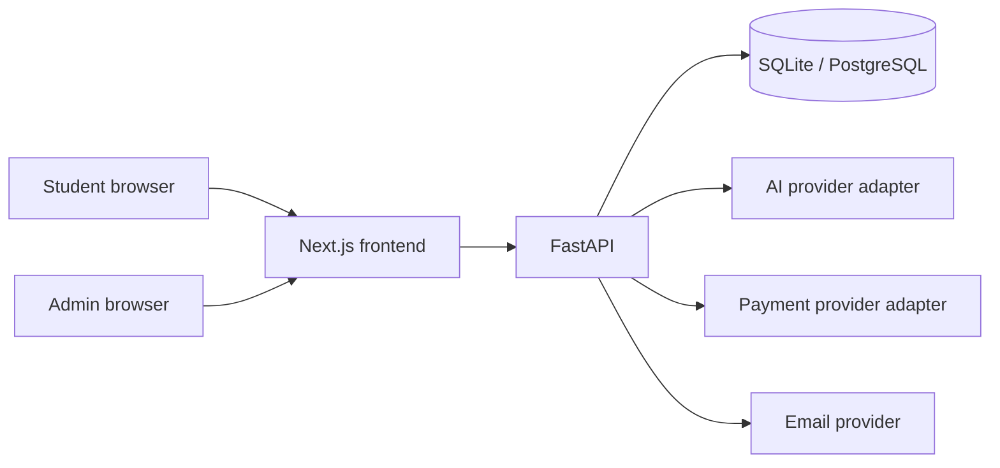

# Architecture

The target system uses a Next.js App Router client, a FastAPI JSON API, and a SQLAlchemy-managed relational database. SQLite is the local default; production uses PostgreSQL through `DATABASE_URL`.

`frontend/src/app` owns routes and layouts. `frontend/src/components` contains reusable interface elements. `backend/app/routers` owns HTTP contracts; `services` owns matching, imports, documents, AI, and payments; `models` and `db` own persistence. CSV ingestion is an explicit script and admin workflow.

## Match request flow

The API loads the authenticated student's profile, normalizes GPA, computes IELTS and GPA tier caps, filters active scholarships by level/tier and optional destination/field, then ranks and paginates the eligible set. Funding preferences and optional preferences are never exclusion filters. The detailed implementation is specified in [MATCHING_LOGIC.md](MATCHING_LOGIC.md).