# Architecture

The target system uses a Next.js App Router client, a FastAPI JSON API, and a SQLAlchemy-managed relational database. Docker Compose runs PostgreSQL 16; `DATABASE_URL` selects the database (SQLite remains only for the isolated pytest suite).

`frontend/src/app` owns routes and layouts. `frontend/src/components` contains reusable interface elements. `backend/app/routers` owns HTTP contracts; `services` owns matching, imports, documents, AI, and payments; `models` and `db` own persistence. CSV ingestion is an explicit script and admin workflow.

## High-level summary

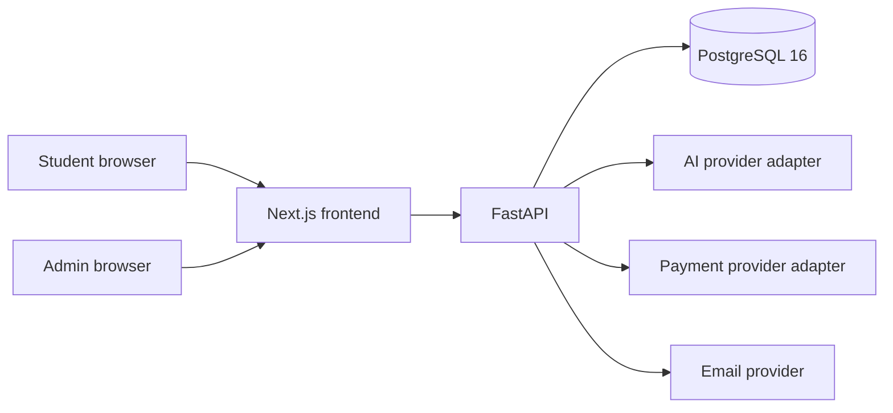

## Current system diagrams

Rendered diagrams are stored in [`diagrams/`](diagrams/) as both PNG and SVG, with editable Mermaid sources in `*.mmd`. Each diagram below shows the rendered image; the Mermaid source is in the collapsible block for editing.

### 1. Runtime and deployment topology

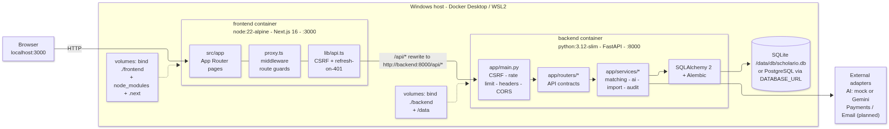

Mermaid source

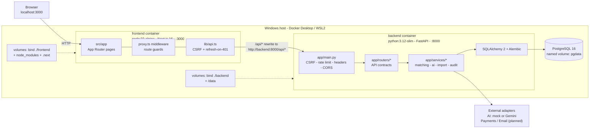

### 2. Layered application architecture

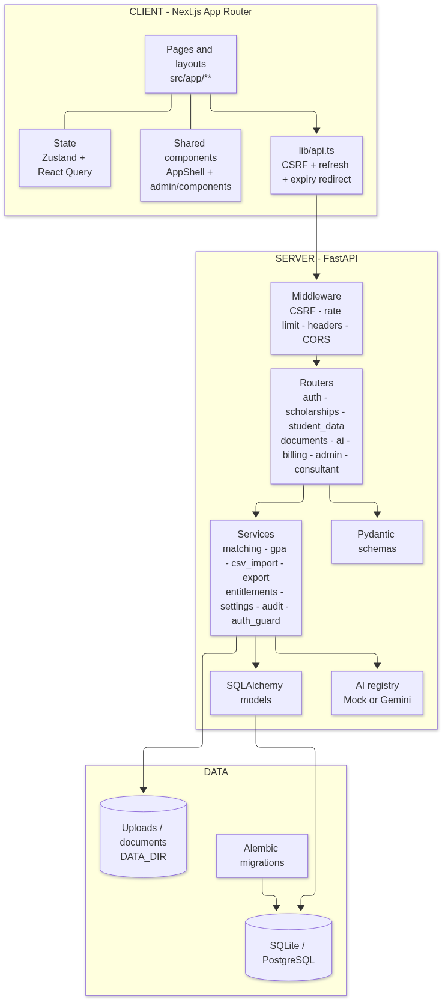

Mermaid source

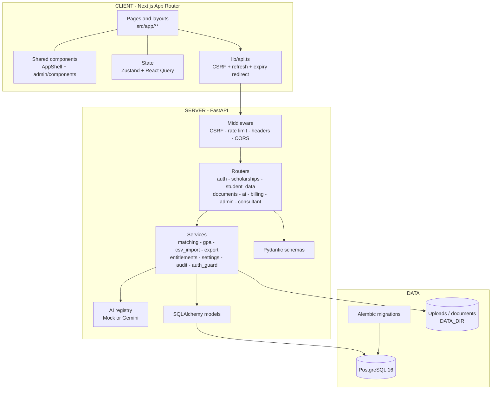

### 3. Authentication, session, and CSRF flow

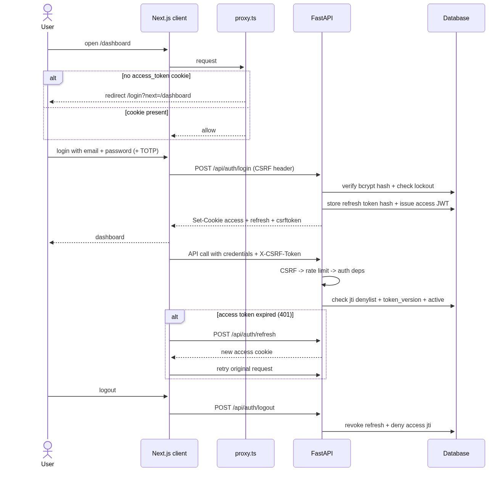

Mermaid source

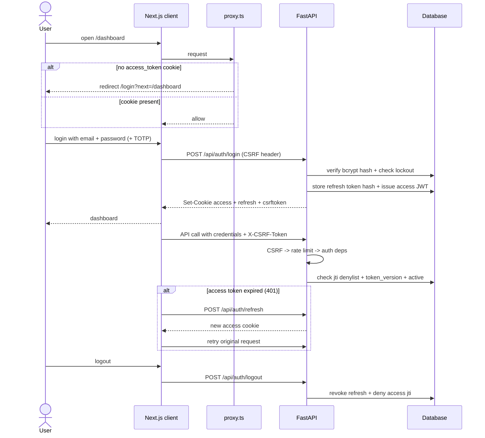

### 4. Scholarship matching flow

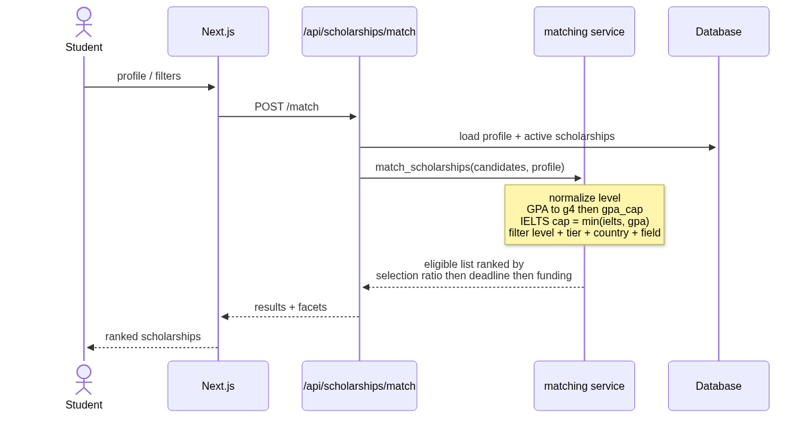

Mermaid source

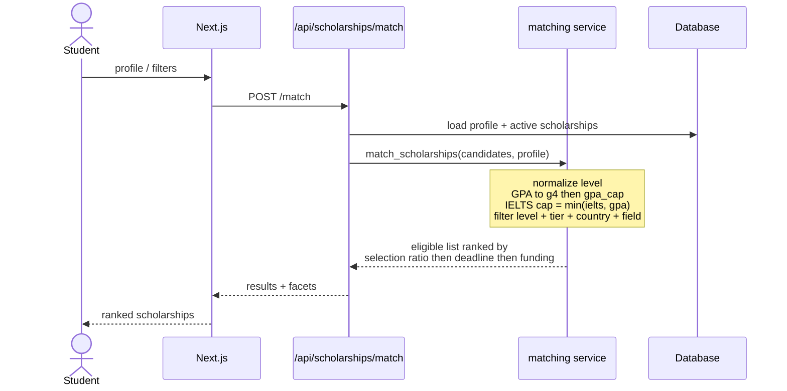

### 5. Data model (core entities)

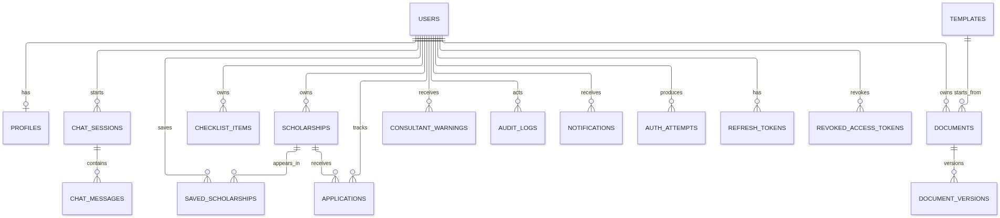

Mermaid source

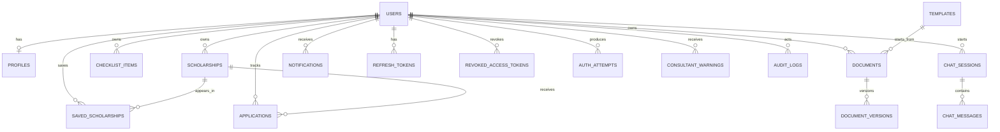

### 6. Roles and access map

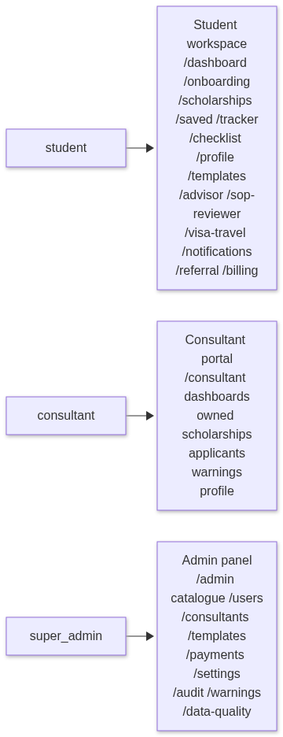

Mermaid source

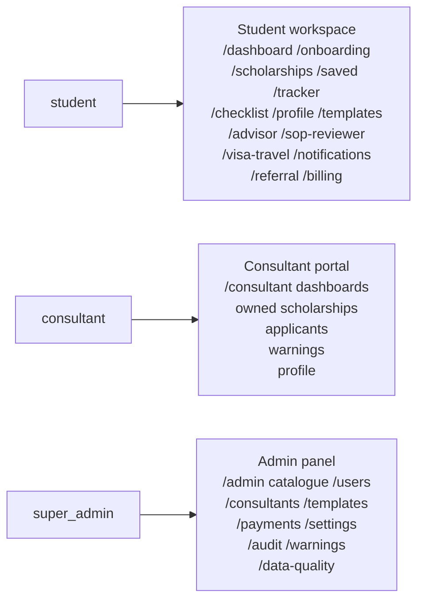

## Component responsibilities

| Layer | Location | Responsibility |
| --- | --- | --- |
| Routes and layouts | `frontend/src/app` | Student, admin, and consultant pages plus route groups |
| Route guards | `frontend/src/proxy.ts` | Cookie-based redirects for protected, admin, and consultant routes |
| API client | `frontend/src/lib/api.ts` | CSRF header, refresh-on-401, session-expiry redirect |
| HTTP contracts | `backend/app/routers` | Validation and response shapes for every `/api/*` route |
| Business logic | `backend/app/services` | Matching, GPA, CSV import/export, entitlements, settings, audit, auth guard |
| AI | `backend/app/services/ai` | Provider registry with mock and Gemini adapters |
| Persistence | `backend/app/models`, `backend/app/db` | SQLAlchemy 2 models and session management |
| Schema evolution | `backend/alembic` | Versioned migrations run on backend startup |

Core entities: users have one profile; profiles match scholarships; users save scholarships and create applications/checklist items; documents belong to users and may reference templates and scholarships; chat sessions own messages; payments and audit records retain operational history. Scholarship IDs come from the source CSV and duplicate titles are valid. See [DATABASE.md](DATABASE.md) for role and ownership details.

## Match request flow

The API loads the authenticated student's profile, normalizes GPA, computes IELTS and GPA tier caps, filters active scholarships by level/tier and optional destination/field, then ranks and paginates the eligible set. Funding preferences and optional preferences are never exclusion filters. The detailed implementation is specified in [MATCHING_LOGIC.md](MATCHING_LOGIC.md).

## Regenerating diagrams

Each `docs/diagrams/*.mmd` file is the editable source for the matching `*.png` and `*.svg`. After editing a source, re-render it with any Mermaid CLI or a hosted renderer, then commit the updated image alongside the source.
