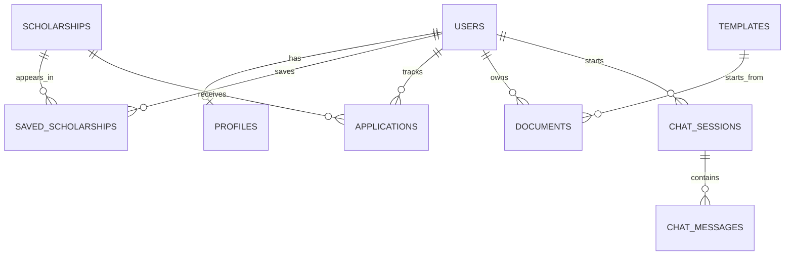

# Database

SQLAlchemy 2 models and Alembic migrations will own schema evolution. Use SQLite for local development and PostgreSQL for deployment. `DATABASE_URL` selects the database.

Core entities: users have one profile; profiles match scholarships; users save scholarships and create applications/checklist items; documents belong to users and may reference templates and scholarships; chat sessions own messages; payments and audit records retain operational history. Scholarship IDs come from the source CSV and duplicate titles are valid.

Full column definitions will be recorded with the model and migration milestone.