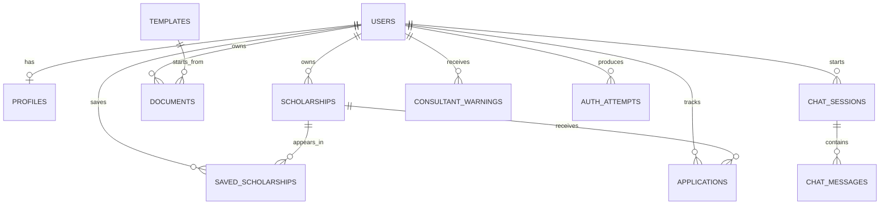

# Database

SQLAlchemy 2 models and Alembic migrations own schema evolution. Docker Compose runs PostgreSQL 16 for local development and deployment; `DATABASE_URL` selects the database (SQLite remains supported for the isolated pytest suite).

Core entities: users have one profile; profiles match scholarships; users save scholarships and create applications/checklist items; documents belong to users and may reference templates and scholarships; chat sessions own messages; payments and audit records retain operational history. Scholarship IDs come from the source CSV and duplicate titles are valid.

Role and ownership changes (migration `0011_roles_ownership_2fa`):

- `users.role` is one of `student`, `consultant`, `super_admin` (legacy `admin` rows become `super_admin`); `users` also gain `totp_secret`, `totp_enabled`, and `totp_recovery_codes` for TOTP second-factor auth.
- `scholarships.owner_id` (FK `users.id`, `ON DELETE SET NULL`) attributes a listing to the consultant who provides it; super admins may own or reassign listings.
- `auth_attempts` records sign-in attempts (`email`, `ip`, `succeeded`, `created_at`) to drive the failed-login lockout.
- `consultant_warnings` stores platform/auto warnings (`consultant_id`, `issued_by_id`, `severity`, `category`, `reason`, `detail`, `is_acknowledged`, `acknowledged_at`, `created_at`).

Full column definitions will be recorded with the model and migration milestone.