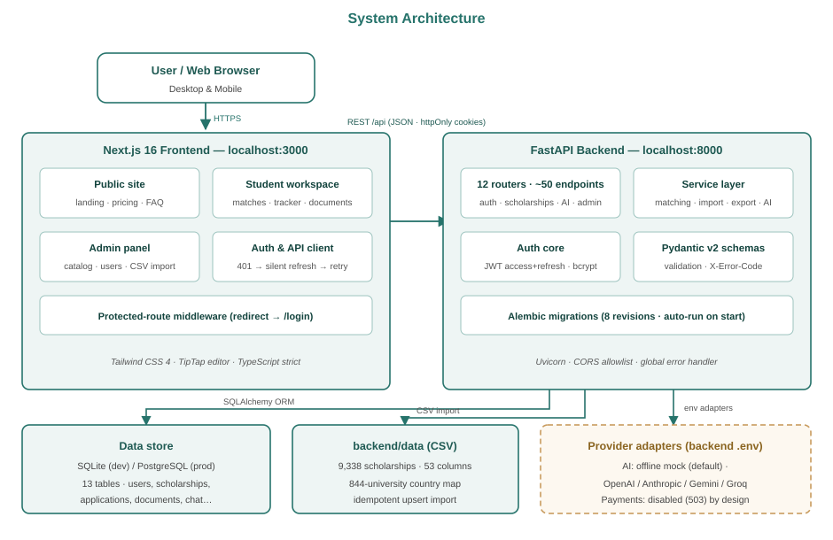
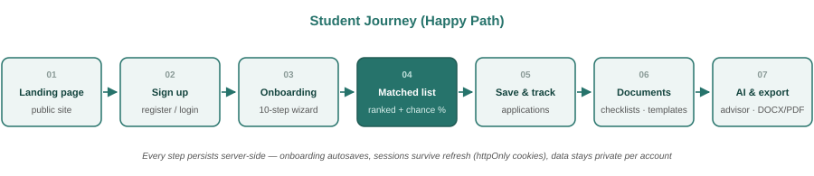
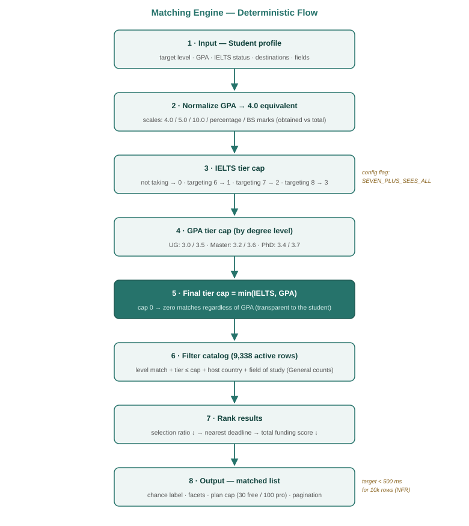
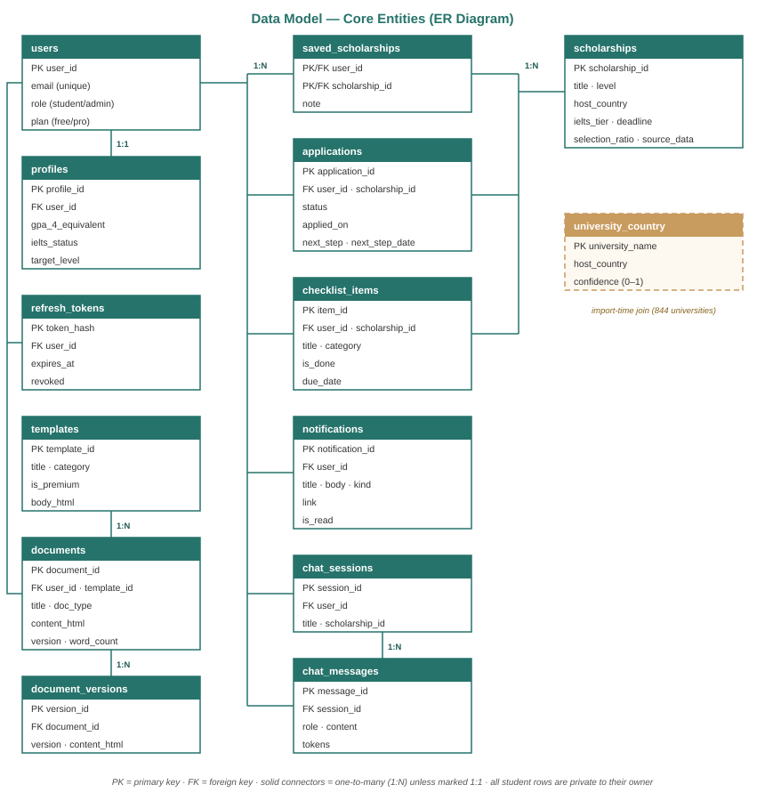

# Scholario — Software Requirements Document

| | |
|---|---|
| **Document version** | 1.1 |
| **Date** | 2026-10-08 |
| **Status** | Draft for review |
| **Project** | Scholario — AI-Powered Scholarship Discovery & Application Workspace |
| **Primary users** | Students from Pakistan applying for scholarships abroad |
| **Technology** | FastAPI (Python) + Next.js 16 (TypeScript) + SQLite/PostgreSQL |

[TOC]

---

## 1. Introduction

### 1.1 Purpose

This document specifies the complete requirements of the Scholario web application. It is the reference for development, testing, and acceptance of the system. Every requirement carries a unique identifier (FR-xxx for functional, NFR-xxx for non-functional) and a priority (Must / Should / Could).

### 1.2 Product overview

Scholario helps students discover scholarships they are actually eligible for, organize their applications, and prepare application documents with AI assistance. The system imports a scholarship catalog of **9,338 programs (53 data columns)**, matches students against it using a **deterministic eligibility engine**, and provides a full application workspace: saved lists, application tracker, checklists, document templates with export, and an AI advisor.

### 1.3 Goals

1. Replace manual scholarship searching with profile-based matching and transparent chance indicators.
2. Keep every application organized (saved list, tracker, checklists, deadlines) in one place.
3. Accelerate document writing (SOPs, letters) with templates and AI review.
4. Give administrators tools to curate the catalog via CSV import and a web UI.

### 1.4 Scope

| In scope | Out of scope (current phase) |
|---|---|
| Public site, student workspace, admin panel | Native mobile apps |
| Scholarship matching, browsing, comparison | Real-time scholarship crawling/scraping |
| Application tracking, checklists, notifications | Email delivery (in-app only for now) |
| Document templates, versioning, DOCX/PDF export | Collaborative/co-authored editing |
| AI advisor, SOP review (offline mock default) | Guaranteed live LLM responses |
| CSV import & catalog administration | Live payment processing (interface only) |

### 1.5 Definitions

| Term | Meaning |
|---|---|
| IELTS tier | Eligibility band level 0–3 derived from the student's IELTS status |
| Tier cap | Highest scholarship IELTS tier the student may see |
| Selection ratio | Percentage of applicants selected (Pakistani data) |
| Chance label | Good (≥10%) / Moderate (≥4%) / Competitive (<4%) |
| Match | A scholarship passing all eligibility filters for a student |

---

## 2. System Overview

### 2.1 Architecture

The system is a two-service web application: a Next.js frontend serving pages and a FastAPI backend exposing a JSON API. Both run as Docker containers locally; the backend owns the database and all business logic.

*Figure 1 — System architecture.*

### 2.2 User roles

| Role | Description | Access |
|---|---|---|
| **Visitor** | Not logged in | Public pages, public scholarship catalog, register/login |
| **Student** | Registered user | Onboarding, matching, full workspace, documents, AI tools |
| **Admin** | Privileged account | Everything a student has + catalog curation, CSV import, user management |
| **Operator** | Maintainer | Environment, database, deployment, provider configuration |

### 2.3 Student journey

*Figure 2 — Primary user flow (happy path).*

### 2.4 Operating environment

| Aspect | Requirement |
|---|---|
| Client | Modern browser (Chrome, Edge, Firefox, Safari); desktop + mobile |
| Frontend hosting | Node.js 22 / Next.js on port **3000** |
| Backend hosting | Python 3.12 / Uvicorn on port **8000** (OpenAPI at `/docs`, health at `/health`) |
| Database | SQLite (development) / PostgreSQL (production) via `DATABASE_URL` |
| Orchestration | Docker Compose (healthchecks, named volumes); Nginx reverse-proxy sample included |
| CI | GitHub Actions — Ruff + pytest (≥80% coverage), ESLint + production build |

---

## 3. Functional Requirements

Priority: **M** = Must (core), **S** = Should (important), **C** = Could (nice to have).

### 3.1 Authentication & account management

| ID | Requirement | Pri |
|---|---|---|
| FR-001 | Register with full name, email, and password (min 8 chars) with unique-email enforcement. | M |
| FR-002 | Authenticate via email + password and establish a signed session. | M |
| FR-003 | Issue two HttpOnly cookies: access token (30 min, path `/`) and refresh token (14 days, path `/api/auth`). | M |
| FR-004 | Rotate refresh tokens on every refresh; store SHA-256 hashes server-side with revoke support (logout, password change, account deletion). Denylist the access token `jti` on logout so it is rejected immediately (`AUTH_REVOKED`). | M |
| FR-005 | Provide a separate admin login that rejects non-admin accounts (`AUTH_ADMIN_REQUIRED`). | M |
| FR-006 | Let students view their profile, change password (revoking all sessions), and delete their own account with data cascade. | M |

### 3.2 Onboarding & profile

| ID | Requirement | Pri |
|---|---|---|
| FR-007 | Provide a 10-step onboarding wizard: name, origin country, target level, destinations, fields, IELTS, GPA/marks, funding preference, nice-to-haves, review. | M |
| FR-008 | Autosave each step independently so users can leave and resume without data loss. | M |
| FR-009 | Convert GPA from scales 4.0 / 5.0 / 10.0 / percentage / BS marks (obtained vs total) to a 4.0-equivalent value. | M |
| FR-010 | Allow students to edit profile and preferences after onboarding. | M |

### 3.3 Scholarship discovery & matching

| ID | Requirement | Pri |
|---|---|---|
| FR-011 | Maintain an active catalog of 9,338 records with level, title, university, type, host country, IELTS, fields, documents, deadline, selection ratio, funding, and URL. | M |
| FR-012 | Expose public browse API with filters: query, level, country (multi), field (multi), IELTS tier, type, deadline-before, sort, pagination. | M |
| FR-013 | Compute an IELTS tier cap (0–3) and a GPA tier cap from per-level thresholds (see §4). | M |
| FR-014 | Filter by active status, degree level, tier ≤ min(caps), host country, and intersecting field of study (General/Any Field counts for all). | M |
| FR-015 | Rank by selection ratio (desc), then nearest deadline, then funding score; return facet counts for country/field/tier/type. | M |
| FR-016 | Label each result: **Good chance** (≥10%), **Moderate** (≥4%), **Competitive** (<4%); cap results at 30 (free) / 100 (pro). | M |
| FR-017 | Provide scholarship detail (sanitized HTML), similar-scholarship suggestions, and side-by-side comparison of 1–3 scholarships. | M |

### 3.4 Student workspace

| ID | Requirement | Pri |
|---|---|---|
| FR-018 | Save/unsave scholarships with an optional note; saved lists are private to their owner. | M |
| FR-019 | Track applications with statuses (planning, preparing, submitted, offer, rejected, expired), applied date, next step, next-step date, and notes. | M |
| FR-020 | Auto-generate a per-scholarship checklist from required documents and requirement flags (attestation, medical, police clearance, account, language test), idempotently. | M |
| FR-021 | Support manual checklist items with title, category, due date, completion toggle, and progress display. | M |
| FR-022 | Deliver per-user notifications with read/unread state and "mark all read". | S |

### 3.5 Documents & templates

| ID | Requirement | Pri |
|---|---|---|
| FR-023 | Seed a template library (8 now, 30 planned): SOP, motivation letter, recommendation letter, CV, research statement, etc., with placeholders, word-range guidance, and tips. | M |
| FR-024 | Provide a rich-text editor (TipTap) to create documents from templates with safe `{{placeholder}}` fill (HTML sanitized, no script injection). | M |
| FR-025 | Maintain full version history with restore, duplicate, and delete — restricted to the document owner. | M |
| FR-026 | Export documents as DOCX, PDF, and TXT. | M |
| FR-027 | Enforce plan limits: free plan max 5 documents; premium templates require `pro` plan. | S |

### 3.6 AI tools

| ID | Requirement | Pri |
|---|---|---|
| FR-028 | Provide AI advisor chat with persisted private sessions (role, content, token counts); answers grounded in real retrieved scholarship records — never inventing opportunities. | M |
| FR-029 | Provide SOP review: 0–100 score with sub-scores (structure, clarity, goals, evidence, grammar, fit) and a concrete issues list. | M |
| FR-030 | Provide text improvement (instruction-based rewriting, sanitized) and scholarship explanation endpoints. | S |
| FR-031 | Provide rule-based eligibility check returning `possible` / `review` / `unknown` with a disclaimer. | M |
| FR-032 | Keep the AI layer provider-neutral behind a registry (`AI_PROVIDER`): mandatory offline mock by default; API keys only in backend `.env`, never exposed to the browser. | M |

### 3.7 Referral, visa & billing

| ID | Requirement | Pri |
|---|---|---|
| FR-033 | Give each student a unique referral code and referral statistics. | C |
| FR-034 | Provide public visa guides per country: steps timeline, required documents, official links. | S |
| FR-035 | Expose a billing skeleton: plan listing and history; checkout returns `503 PAYMENTS_DISABLED` until a verified provider is enabled (Stripe; Safepay/JazzCash/Easypaisa/PayFast for Pakistan; manual bank transfer). | S |

### 3.8 Administration

| ID | Requirement | Pri |
|---|---|---|
| FR-036 | Provide separate protected admin sign-in; admin routes return 403 for students. | M |
| FR-037 | Show platform statistics on the admin dashboard (users, scholarships, activity). | S |
| FR-038 | Allow inline editing of scholarship metadata (title, country, deadline, active flag, …). | M |
| FR-039 | Allow CSV import up to 25 MB with a validation report; idempotent upsert by `scholarship_id`; admin country corrections survive re-import. | M |
| FR-040 | List universities with unmapped/low-confidence host countries (600 names / 3,041 rows) and let admins assign the correct country. | M |
| FR-041 | Let admins list users and change plan (`free`/`pro`) and access status. | S |

**Totals: 41 functional requirements — 33 Must, 7 Should, 1 Could.**

---

## 4. Matching Engine Specification

The matcher is fully deterministic (no AI): same profile always yields the same result, and every exclusion is explainable.

*Figure 3 — Matching engine flow.*

### 4.1 Tier rules

**IELTS tier cap** (from student's IELTS status):

| Status | Tier cap |
|---|---|
| Not taking IELTS | 0 (no matches) |
| Targeting band 6 | 1 |
| Targeting band 7 | 2 (3 if `SEVEN_PLUS_SEES_ALL` flag is set) |
| Targeting band 8 | 3 |

**GPA tier thresholds by target degree level:**

| Level | Tier 1 | Tier 2 | Tier 3 |
|---|---|---|---|
| Undergraduate | 3.0 | 3.5 | — |
| Master | 3.2 | 3.6 | — |
| PhD | 3.4 | 3.7 | — |

**Final cap** = min(IELTS tier cap, GPA tier cap). A scholarship is included only if its `ielts_tier ≤ final cap`.

### 4.2 Ranking

1. `selection_ratio_percent` descending (less competitive first),
2. nearest upcoming `deadline_date`,
3. `total_funding_score` descending.

Origin country, funding preference, and nice-to-have preferences are **stored but never used as filters** (decision record #5).

### 4.3 Chance labels

| Selection ratio | Label |
|---|---|
| ≥ 10% | Good chance |
| ≥ 4% | Moderate |
| < 4% | Competitive |

---

## 5. Non-Functional Requirements

### 5.1 Performance

| ID | Requirement | Pri |
|---|---|---|
| NFR-001 | Match requests respond in **under 500 ms** for a 10,000-row catalog. | M |
| NFR-002 | Browse/detail endpoints paginate; the frontend never loads the full catalog to render a view. | M |
| NFR-003 | Frontend production build completes with zero errors; ESLint and Ruff pass. | M |

### 5.2 Security

| ID | Requirement | Pri |
|---|---|---|
| NFR-004 | Passwords stored with bcrypt (bcrypt_sha256); never plain text. | M |
| NFR-005 | Auth tokens only in HttpOnly + SameSite cookies — never in `localStorage`. | M |
| NFR-006 | Refresh tokens hashed server-side, rotated on use, revocable. | M |
| NFR-007 | Per-user isolation of saved items, applications, checklists, documents, and chat — verified by automated tests. | M |
| NFR-008 | All stored/derived HTML sanitized before rendering (allowed tags only; scripts stripped). | M |
| NFR-009 | Secrets only in backend `.env`, excluded from Git; production requires `SECRET_KEY` ≥ 32 chars. | M |

### 5.3 Reliability & quality

| ID | Requirement | Pri |
|---|---|---|
| NFR-010 | Schema changes versioned with Alembic; a fresh clone migrates automatically on startup. | M |
| NFR-011 | CSV import idempotent and repeatable without duplicating rows. | M |
| NFR-012 | Backend service test coverage **≥ 80%** enforced in CI (current: 81.37%, 43 tests). | M |
| NFR-013 | CI runs Ruff + pytest (backend) and ESLint + build (frontend) on every push/PR. | M |

### 5.4 Usability & compatibility

| ID | Requirement | Pri |
|---|---|---|
| NFR-014 | Responsive layout across phone, tablet, desktop (mobile bottom tabs, desktop sidebar). | M |
| NFR-015 | Public landing is a static, SEO-friendly page with metadata. | S |
| NFR-016 | Consistent error contract: HTTP status + `detail` + machine-readable `code` (`X-Error-Code`). | M |
| NFR-017 | Full offline development: SQLite + mock AI, no external service required. | M |

### 5.5 Maintainability

| ID | Requirement | Pri |
|---|---|---|
| NFR-018 | Code separated into `backend/`, `frontend/`, legacy prototypes isolated in `frontend/prototype/`, data in `backend/data/`. | M |
| NFR-019 | Business logic in service modules separate from HTTP routers, unit-testable in isolation. | M |
| NFR-020 | Configuration environment-driven (`.env`), documented in `.env.example`. | S |

**Totals: 20 non-functional requirements — 18 Must, 2 Should.**

---

## 6. Data Requirements

### 6.1 Data model

*Figure 4 — Core entities (13 tables; simplified to key columns).*

### 6.2 Data rules

1. Retain all 9,338 source scholarship rows and original `scholarship_id`; store raw source columns for traceability.
2. Normalize booleans (value + original note), list fields, IELTS tier, deadlines, selection ratio, funding score, and host country (unmapped → "Unknown", flagged for admin review).
3. Database university-country rows are authoritative after initial seed — admin corrections survive re-imports.
4. All student data (profiles, saved, applications, checklists, documents, chat) is private per user.
5. Referential integrity: users → profiles / tokens / saved / applications / checklist / notifications / documents / chat sessions; documents → versions; chat sessions → messages.
6. In local Docker deployments the database file lives on a named volume (not a Windows bind mount).

---

## 7. External Interfaces

| Interface | Description |
|---|---|
| Browser UI | Served by Next.js on port 3000; protected routes redirect to `/login` when unauthenticated. A dead session (refresh rejected) clears the cookies and redirects to `/login`, or `/admin/login` on admin routes, once per expiry. |
| JSON API | FastAPI on port 8000; OpenAPI documentation at `/docs`; machine-readable error codes. |
| CSV import | Admin upload ≤ 25 MB or CLI script; files under `backend/data/`. |
| AI providers | Pluggable adapters via backend environment variables (default: offline mock). |
| Payments | Provider adapter interface with webhook verification (disabled by default). |
| Reverse proxy | Nginx sample: `/api/*` and `/health` → backend, all other paths → frontend; 25 MB body limit. |

---

## 8. Technical Requirements

| Area | Technology / requirement |
|---|---|
| Frontend | Next.js 16 App Router, TypeScript (strict), Tailwind CSS 4, TipTap 3, React Hook Form, TanStack Query, Zustand, Recharts |
| Backend | FastAPI, SQLAlchemy 2 (typed ORM), Pydantic v2, Alembic, Uvicorn |
| Database | SQLite (dev) / PostgreSQL (prod) via `DATABASE_URL` |
| Auth | JWT HS256 (python-jose) + bcrypt (passlib), HttpOnly cookie flow with rotation and logout-time access-token denylist |
| Testing | pytest + httpx (70 tests), coverage gate 80%, Ruff; ESLint + `tsc --noEmit` + `next build` |
| Deployment | Docker Compose (backend :8000, frontend :3000), healthchecks, named volumes |
| Data | pandas CSV importer; 9,338 rows × 53 columns; 844-university country map |
| CI/CD | GitHub Actions — Python 3.12 backend job, Node 22 frontend job |

---

## 9. Acceptance Criteria

| # | Criterion | Status |
|---|---|---|
| AC-1 | New student registers → completes 10-step onboarding → receives matched scholarships in < 500 ms. | ✅ Met |
| AC-2 | Match results respect IELTS/GPA tier caps and show chance labels; facets allow further filtering. | ✅ Met |
| AC-3 | Student saves a scholarship, adds it to the tracker, generates its checklist, receives notifications — all private to that account. | ✅ Met |
| AC-4 | Student creates a document from a template, autosaves, restores a previous version, exports DOCX/PDF/TXT. | ✅ Met |
| AC-5 | AI advisor answers from real catalog data; SOP reviewer returns structured scores — fully offline with mock provider. | ✅ Met |
| AC-6 | Admin logs in, edits a scholarship, imports CSV with accurate report, maps an unknown university's country. | ✅ Met |
| AC-7 | Automated checks pass: Ruff clean, 43/43 tests, coverage ≥ 80%, ESLint clean, production build OK, Compose healthy end-to-end. | ✅ Met |
| AC-8 | Cross-user access to another student's data returns empty/denied (privacy verified by tests). | ✅ Met |

---

## 10. Current Limitations

| # | Pending requirement | Status |
|---|---|---|
| 1 | Real LLM provider wiring (OpenAI/Anthropic/…) | Interface ready; mock only |
| 2 | Live payment processing | Checkout disabled (503) by design |
| 3 | Remaining 22 of 30 document templates | 8 seeded |
| 4 | Email verification & password reset | Not implemented |
| 5 | Rate limiting (brute-force protection) | Library installed, not activated |
| 6 | Admin announcements, audit log, payment management | Skeleton only |
| 7 | Playwright E2E + Lighthouse CI gates | Not yet added |
| 8 | Production deployment guide (VPS/TLS/backups) | Outline only |

---

## 11. References

| Document | Contents |
|---|---|
| `SCHOLARIO_MASTER_PROMPT.md` | Product vision and build specification (acceptance flow: §24) |
| `docs/MATCHING_LOGIC.md` | Detailed matching engine rules |
| `docs/API.md` | Full endpoint reference (~50 routes) |
| `docs/PROGRESS.md` | Implementation status per milestone |
| `docs/ARCHITECTURE.md`, `docs/DATABASE.md` | System design and schema |
| `docs/SRS.md` | Summary software requirements specification |
